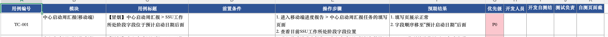

# CasePilot P0 需求

状态：2026-10-30 范围已确认并持续更新；M1 和当前 Web/导入确认阶段已做本机验证，完整 P0 尚未完成，按阶段沟通调整。
需求变更查阅 [决策记录](decisions.md)，技术假设查阅 [参考资料](references.md)。

## 1. 目标与非目标

P0 要让一个人在本机完成：导入已有 Excel 用例，指定被测系统及环境，让 Agent 理解用例并实际操作桌面网页，输出可复查的测试报告。
最终产品必须支持 Windows 与 macOS；安装、启动、浏览器操作、本地数据和凭证保存、停止及进程清理均需兼容并分别验证。
用户于 2026-10-30 将 Windows 实机验证延后；当前继续其他 P0 功能与 macOS 验收，最终跨平台支持要求保留。
长期目标是“需求分析 → 生成用例 → 执行 → 报告”，需求分析与用例生成不属于本次 P0。

不做移动端/真机、并行执行、多租户、团队权限、对话式任务入口、跨角色用例、任意验证码破解、插件市场、跨进程自动续跑。
支持多种常见 Excel 排布，不承诺任意工作簿都能无歧义导入。

## 2. 用户流程

1. 在环境管理中创建被测系统及环境，填写地址、可选登录地址、用户名和密码。
2. 上传 Excel，选择需要导入的工作表。
3. 系统定位表头，识别字段、用例边界、前置条件、步骤和预期结果。
4. 展示解析结果及原始位置；用户可以修正映射、用例拆分和明显的识别错误。
5. 对未解决的问题补充信息或排除对应条目，确认本次用例集。
6. 选择环境并开始任务；Agent 打开本机可见浏览器，自动登录。
7. 依次检查/准备前置条件，执行操作，逐项验证预期结果并记录证据。
8. 在页面查看状态、进度和结果，完成后查看并下载 HTML 报告。

导入确认只是确认识别结果，不自动放宽用例预期。后台不得替用户忽略无法理解的用例。

## 3. Excel 输入

用户提供了模板截图，原始 xlsx 文件尚未提供。不能根据截图声称已经验证合并单元格、工作表结构或公式。

已能明确看到的核心字段：
- 用例编号、模块、用例标题。
- 前置条件、操作步骤、预期结果。
- 优先级。
- 开发/测试人员、自测结论和截图等附加列，保留原始信息，不参与业务通过率计算。

截图示例 TC-001 涉及“SSU 工作所处阶段”与“预计启动日期”的字段顺序。首版只测试桌面 Web；截图中的移动端字样不改变已确认范围。

需支持的常见差异：表头别名、列顺序、表头前说明行、多个工作表、单元格内多行步骤、一个用例跨多行，以及通过合并区域表达用例归组。
Excel 解析工具负责单元格与合并范围，模型辅助识别语义。两者都不能跳过人工确认。
密码保护、纯图片用例、无法取到有效值的公式、无法确定步骤与预期对应关系，要明确提示，不编造内容。
不执行公式、宏、外部链接或文件内的指令。

每条规范化用例保留原文件名、sheet、原始行号、原始文本与用户确认的修订版本。
外部编号可能重复：内部 ID 必须唯一，显示重复项并要求确认，不覆盖原有用例。
步骤与预期结果是分别编号的列表，数量可以不同，不机械地按序号一一配对。

## 4. 环境与账号

- 可管理多个系统，每个系统可有多个环境。
- 每个环境一组账号，不在单条用例中切换账号。此决定替代此前讨论过的多账号方案。
- 环境有名称、系统地址、可选登录地址、用户名、密码和验证码处理方式。
- 支持用户名密码自动登录。登录与登录测试用例要区分，测试步骤要求退出或重新登录时按用例执行。
- 支持普通字符图片验证码识别与有限重试；也可配置测试专用验证码或取码能力。
- 短信/邮件验证、扫码、滑块、点选或第三方反机器人挑战，不承诺无适配自动完成。需要测试入口或单独适配。
- 密码页面隐藏，日志/事件/报告不得带出原始凭证。截图涉及凭证时需要遮罩或不收录该图。

## 5. 执行能力

- 本机可见浏览器中执行桌面 Web，管理页面展示当前用例、步骤、进度和错误。
- 一次只有一个活动测试任务，任务内部按确认顺序逐条执行。
- 每条用例的前置条件需要 Agent 检查并尽可能通过 UI 准备。
- 前置条件无法准备时记为 BLOCKED；不擅自修改账号权限、猜测业务数据或依赖其他用例的输出。
- 普通操作失败可有限恢复，例如重新获取页面结构、等待页面或重新定位元素。
- 点击“提交/创建”等可能产生数据的操作后结果不明，应先检查是否成功，不能盲目再次提交。
- 不自动从头重跑整条用例，不改变预期以消除失败。
- 单条失败、阻塞或执行异常后继续下一条；系统不可访问、持续无法登录等整体故障暂停整批任务。
- 不能验证预期时不能判为通过。UI 用例不能绕过页面直接调用业务接口替代验证。
- 暂停、继续、停止以及程序中断的建议规则见执行文档，属于本次落档明确列出的实现默认值。

## 6. 报告与统计

页面报告与自包含 HTML 使用同一份结构化执行数据，不能各自让模型重新生成统计。
包括：任务/环境摘要、执行时间、用例来源版本、逐条状态、步骤记录、预期与实际结果、截图及失败分析。
模型分析作为说明，不能覆盖原始步骤证据或篡改结论。
HTML 离线打开不依赖本机临时地址、CDN 或当前运行中的服务，图片需内嵌且已处理敏感内容。

状态和公式详见 [执行规则](execution.md)：
- 通过率 = PASSED / (PASSED + FAILED)。
- 执行完成率 = (PASSED + FAILED) / 本次用例总数。
- 分母为零显示“暂无可判定结果”，不显示 100%。
- BLOCKED、ERROR、CANCELLED、未开始项单列，不加入通过率分母。
- 进行中的进度与执行完成率分开展示，不能用“处理完”冒充“完成验证”。

## 7. 模型与扩展

模型服务可配置 apiKey、baseURL、modelId，优先适配 OpenAI-compatible API。
工具调用与图像输入需要针对实际服务验证；兼容接口名称本身不保证这些能力可用。
MCP、Skills 通过本地配置接入，页面只展示启用情况，不在 P0 增加在线安装和管理功能。
Skills 是可按需读取的能力说明，不等同于权限隔离。扩展只加载用户明确配置的可信来源。

## 8. 本次落档的实现默认值

以下是为形成可实施方案补齐的默认值，不冒称来自单独访谈投票。后续如用户调整，更新决策记录：
- 本机持久化环境、确认后的用例、任务与报告。
- 测试数据默认保留，不额外自动清理；用例明确要求的清理步骤照常执行。
- 支持暂停/继续/停止；服务退出后标记任务中断，不自动继续可能产生业务副作用的步骤。
- 恢复次数、验证码次数、用例/任务超时可配置。示例数字是起点，需要用目标系统测定。
- 界面文案使用简体中文；机密配置留在服务端。
